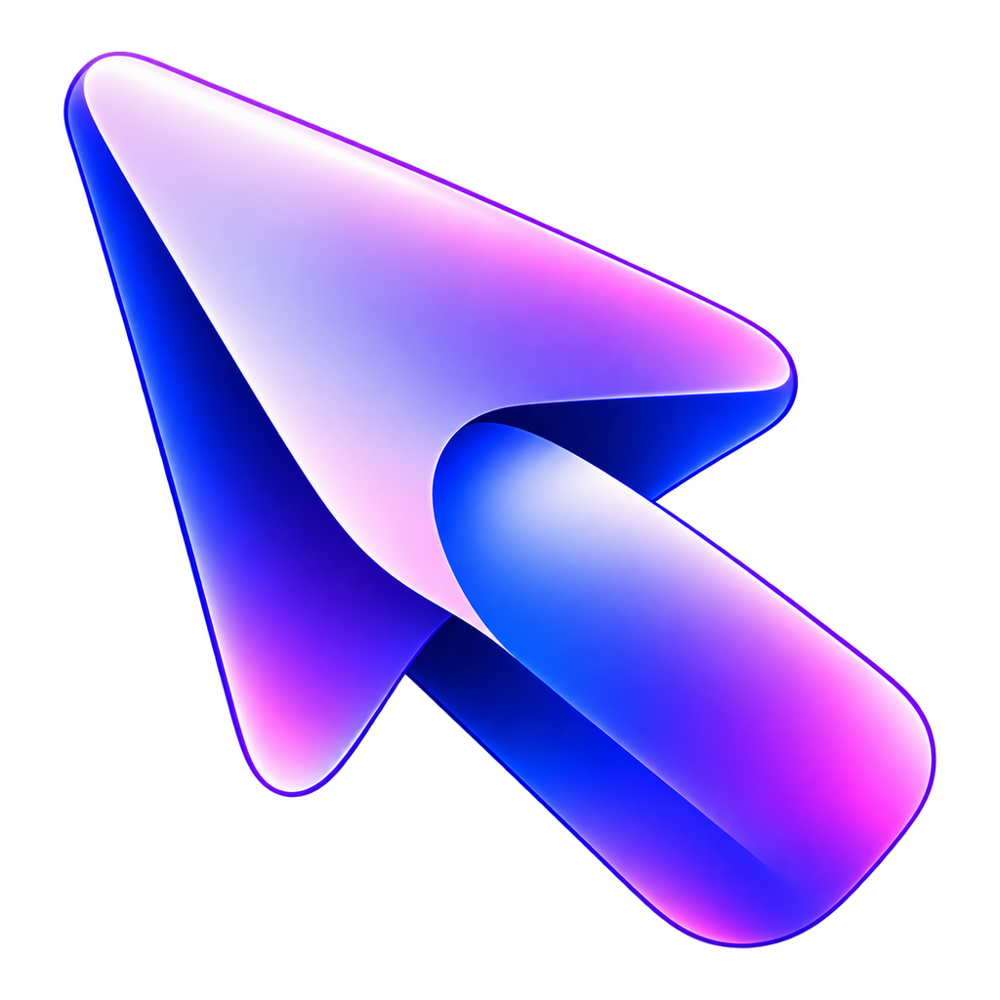

<p align="center"><strong>Русский</strong> / <a href="README.en.md">English</a></p>

<p align="center"></p>
<h1 align="center">CursorMotion</h1>
<p align="center"><strong>Плавное движение. Твой стиль курсора.</strong><br>Моушн-блюр, мягкие переходы форм и стеклянные наборы для Windows.</p>
<p align="center">
  <a href="https://github.com/WAKUDOdani/CursorMotion/releases/download/v3.10.0/CursorMotion-3.10.0-portable-x64.exe"></a>
  <a href="docs/USAGE.md"></a>
</p>
<p align="center">
  <a href="https://github.com/WAKUDOdani/CursorMotion/releases/latest"></a>
  <a href="https://github.com/WAKUDOdani/CursorMotion/actions/workflows/ci.yml"></a>
  <a href="LICENSE"></a>
</p>
<p align="center"><a href="#возможности">Возможности</a> · <a href="docs/USAGE.md">Инструкция</a> · <a href="https://github.com/WAKUDOdani/CursorMotion/releases">Что нового</a> · <a href="https://t.me/WAKUDOdani">Telegram</a> · <a href="https://github.com/WAKUDOdani/CursorMotion/issues">Помощь и ошибки</a></p>
<p align="center"><a href="docs/assets/collection.png"></a><br><sub>Настоящий интерфейс приложения с демонстрационными настройками. Образцы форм рисует тот же движок, что и курсор Windows.</sub></p>

## Возможности

| Что настроить | Что умеет CursorMotion |
| --- | --- |
| **Движение** | Размытие всего изображения курсора вдоль траектории, сглаживание эффектов, наклон и мягкая реакция на нажатие. Системная позиция мыши остаётся точной. |
| **Наборы** | Crystal, Aurora, Carbon, Rose и Classic. Набор можно применить целиком или собрать свой из разных материалов. |
| **Формы** | Стрелка, текст, ожидание, рука и четыре направления изменения размера окна. Между формами — плавное превращение. |
| **Внешний вид** | Отдельные размер, заливка, обводка, тень и длительность перехода для четырёх основных форм. Можно связать их размер одним переключателем. |
| **Пресеты** | Свои наборы всех настроек: сохранить, применить, обновить, удалить и перенести JSON-файлом. |
| **Рабочее место** | Все мониторы, отдельный экран или своя область; трей, автозапуск по желанию, импорт и экспорт профиля. |

<details>
<summary><strong>Посмотреть настройки курсора</strong></summary>

<a href="docs/assets/cursor.png"></a>

Настройки движения и применённый набор сохраняются автоматически. Изменения оформления форм применяются кнопкой; экспорт сохраняет применённый профиль.

</details>

<details>
<summary><strong>Моушн и пользовательские пресеты</strong></summary>

<a href="docs/assets/motion.png"></a>
<a href="docs/assets/presets.png"></a>

Скриншоты сняты в самом приложении на демонстрационном профиле Crystal. Максимальный размер — 4.5×; значения выше не принимаются.

</details>

## Скачать

**Windows x64**, видеокарта с Direct3D 11. Интерфейс приложения — на русском. .NET и Electron уже включены.

| Вариант | Как работает | Обновление |
| --- | --- | --- |
| [**Portable 3.10.0**](https://github.com/WAKUDOdani/CursorMotion/releases/download/v3.10.0/CursorMotion-3.10.0-portable-x64.exe) | Один EXE, без установки и прав администратора | Полностью выйти через трей и заменить EXE новой версией |

[Все выпуски и контрольные суммы](https://github.com/WAKUDOdani/CursorMotion/releases). Для запуска скачай только EXE. `SHA256SUMS.txt` нужен для проверки файла; `Source code` — исходники для разработчиков.

Сборка пока без цифровой подписи издателя Windows. Скачивай файл из этого репозитория и при необходимости сравнивай SHA-256 с суммой в релизе.

## Быстрый старт

1. Скачай EXE в постоянную папку и запусти. Для удобного обновления можно назвать его `CursorMotion.exe`.
2. Выбери набор в **«Коллекции»** и примени его. В **«Движении»** настрой размытие; в **«Курсоре»** — отдельные формы.
3. Закрой окно настроек: эффект останется в трее. **Ctrl + Alt + F8** ставит его на паузу, **Ctrl + Alt + F12** восстанавливает обычный курсор и завершает приложение.

При первом запуске компоненты распаковываются в служебный кэш AppData. Повторные запуски используют проверенный кэш; скачивать что-либо дополнительно не нужно. Рядом с EXE приложение ничего не создаёт.

[Настройки, перенос профиля, автозапуск и запись экрана →](docs/USAGE.md)

## Что стоит знать

- Курсор выводится через системный механизм Windows, поэтому остаётся поверх обычных окон, уведомлений и контекстных меню. Указатели, которые приложение рисует самостоятельно, могут сохранять свой вид.
- Размер ограничен диапазоном **0.5–4.5×** для всех форм, общего размера и импортированных пресетов. Запись NVIDIA с моушном проверена на 4.5×; результат на других драйверах может отличаться. [Как работает запись](docs/USAGE.md#nvidia-и-демонстрация-экрана).
- Настройки находятся в `%LOCALAPPDATA%\CursorMotion\settings.json`. Для переноса на другой ПК используй экспорт и импорт профиля.
- Автозапуск включается отдельно. После переноса EXE в другую папку выключи и снова включи его, чтобы обновить путь.
- При паузе и выходе возвращается зарегистрированная схема Windows. Отдельный процесс следит за восстановлением курсора при остановке движка.

## На связи

[Telegram WAKUDO Dani](https://t.me/WAKUDOdani) — обновления и другие проекты. Ошибки и предложения — в [Issues](https://github.com/WAKUDOdani/CursorMotion/issues). Другой проект автора: [WakuShare](https://github.com/WAKUDOdani/WakuShare).

<details>
<summary><strong>Разработчикам: сборка и проверки</strong></summary>

Windows x64, .NET SDK **10.0.401**, Node.js **24**, PowerShell **7**.

```powershell
pwsh ./prepare-build.ps1
cd desktop/renderer
npm ci
cd ../..
pwsh ./build-single-file.ps1 -SkipTests
pwsh ./tools/verify-package.ps1 -Executable ./dist/single-file/CursorMotion-3.10.0-portable-x64.exe
```

Готовый файл появится в `dist/single-file/`. Параметр `-SkipTests` пропускает проверки на шаге сборки; следующая команда проверяет уже готовый EXE. [Подробнее о сборке и CI](docs/BUILDING.md) · [Порядок выпуска](docs/RELEASING.md).

Обычные проверки используют синтетические данные, приватные курсоры и скрытое окно самого приложения. Они не заменяют живой курсор и не меняют реальный автозапуск. Для CI без видеокарты предусмотрен WARP только в диагностике.

</details>

## Авторство и лицензия

CursorMotion развивает **WAKUDO Dani**. Первоначальная геометрия курсора и интеграция экспозиции адаптированы из OBS-скрипта **Motion Blur Cursor**, распространяемого под Unlicense. OBS для работы приложения не требуется.

[MIT License](LICENSE) · [Сторонние компоненты](THIRD-PARTY-NOTICES.txt) · [Происхождение алгоритма](docs/UPSTREAM.md)
